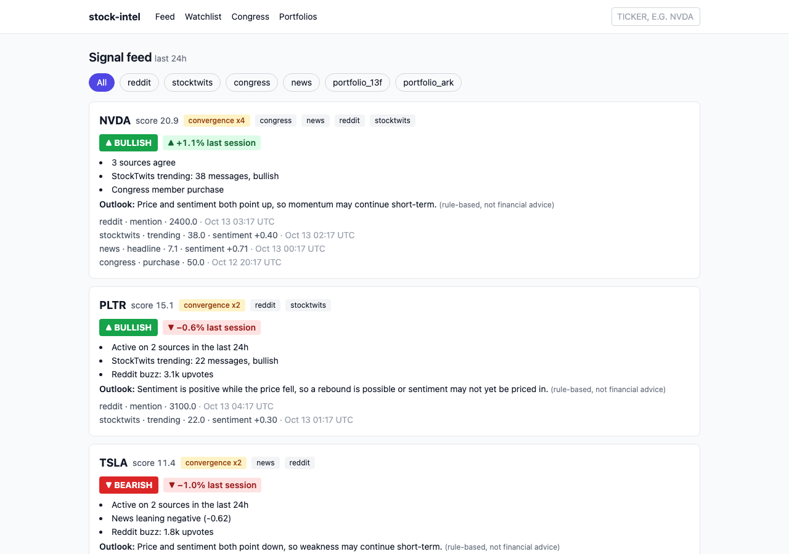
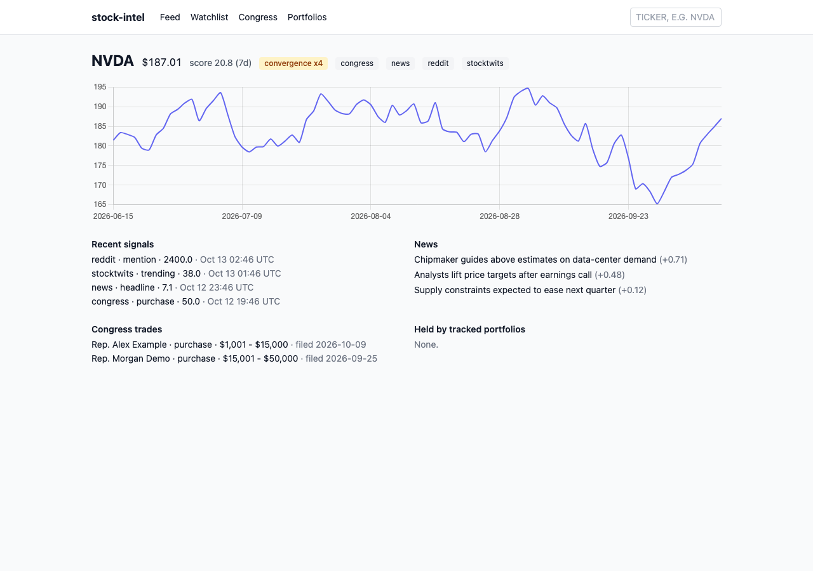
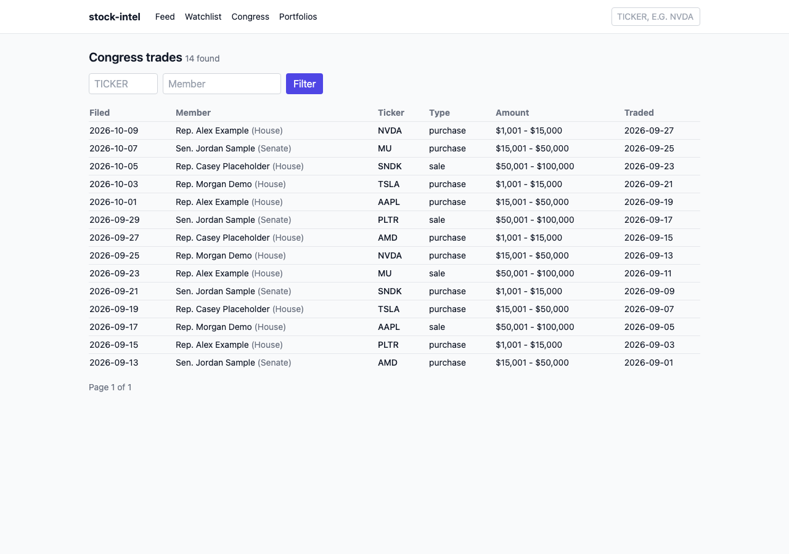
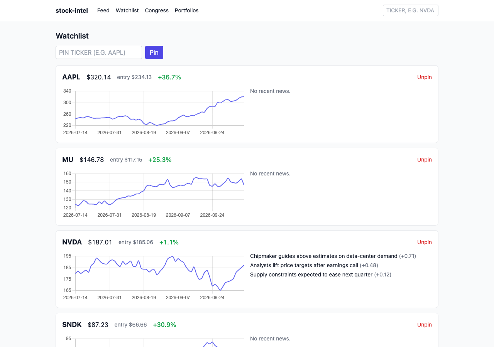

# stock-intel

A local stock-intelligence dashboard that collects market signals from free public sources, scores them, and highlights tickers where several independent sources agree.



## Features

- **Signal feed** – ranks tickers by a combined score over the last 24 hours, filterable by source. Each signal is log-scaled so sources with different units are comparable, weighted per source, and decayed with age.
- **Signal summaries** – each ticker card shows a clear bullish/bearish verdict, the latest session's price move, the signals behind the verdict, and a short rule-based outlook.
- **Convergence detection** – tickers flagged by two or more independent sources within 24 hours receive a score bonus and a visible badge.
- **Ticker pages** – price history chart, recent signals, news with sentiment, Congress trades, and holdings by tracked portfolios.
- **Watchlist** – pinned tickers with price charts, entry price, and return since entry.
- **Congress trades** – House periodic transaction reports, searchable by ticker and member.
- **Portfolio tracking** – quarterly 13F filings from selected funds and the ARK Innovation ETF's daily holdings, with new, increased, reduced, and closed positions surfaced as signals.
- **Daily email digest** – a morning summary of the top signals with optional AI-written commentary from Claude, delivered through SendGrid.

| Ticker detail | Congress trades |
|---|---|
|  |  |



## Data sources

| Source | Signal | Schedule (US Eastern) |
|---|---|---|
| Reddit | Ticker mentions and upvotes | Every 30 min |
| StockTwits | Trending symbols and bull/bear sentiment | Every 15 min |
| NewsAPI | Headlines, scored with VADER sentiment | Daily |
| House Clerk disclosures | Congressional stock trades (PDF filings) | Daily |
| Yahoo Finance | Daily closing prices | Weekdays |
| ARK Invest | ARKK daily holdings | Weekdays |
| SEC EDGAR | 13F institutional holdings | Weekly |

Any source without credentials is skipped, so the app runs with only part of its configuration in place.

## Tech stack

- **Backend:** Python 3.11, Flask, SQLAlchemy, SQLite
- **Scheduling:** APScheduler, running in the same process as the web server
- **Frontend:** server-rendered Jinja templates, htmx, Tailwind CSS, Chart.js
- **Integrations:** PRAW, yfinance, pdfplumber, VADER, Anthropic API, SendGrid
- **Tooling:** pytest, Ruff, GitHub Actions CI

## Getting started

```bash
git clone https://github.com/tkaraki/stock-intel.git
cd stock-intel
python3.11 -m venv .venv
source .venv/bin/activate
pip install -r requirements.txt
cp .env.example .env   # then fill in the API keys to enable each source
python run.py
```

The dashboard is served at <http://127.0.0.1:5000>. On first start the app creates its SQLite database under `data/` and seeds a starter watchlist and the tracked portfolios.

## Configuration

All settings are read from `.env`; `.env.example` lists every option with placeholder values.

| Setting | Purpose |
|---|---|
| `REDDIT_CLIENT_ID`, `REDDIT_CLIENT_SECRET`, `REDDIT_USER_AGENT` | Reddit API access |
| `NEWSAPI_KEY` | News headlines |
| `SEC_EDGAR_COMPANY_NAME`, `SEC_EDGAR_EMAIL` | Contact details SEC EDGAR requires on every request |
| `ANTHROPIC_API_KEY`, `ANTHROPIC_MODEL` | AI commentary in the daily digest |
| `SENDGRID_API_KEY`, `DIGEST_FROM_EMAIL`, `DIGEST_TO_EMAIL` | Digest delivery |
| `SCHEDULER_ENABLED`, `SCHEDULER_TZ` | Background jobs and the time zone their schedules use |
| `HOST`, `PORT`, `ALLOWED_HOSTS` | Web server binding |
| `DATABASE_URL`, `LOG_LEVEL` | Storage location and log verbosity |

## Running tests

```bash
pip install -r requirements-dev.txt
pytest
ruff check .
```

CI runs the same checks on every push and pull request to `main`.

## Disclaimer

This project is for educational and research purposes only and does not constitute financial advice.

## License

[MIT](LICENSE)
